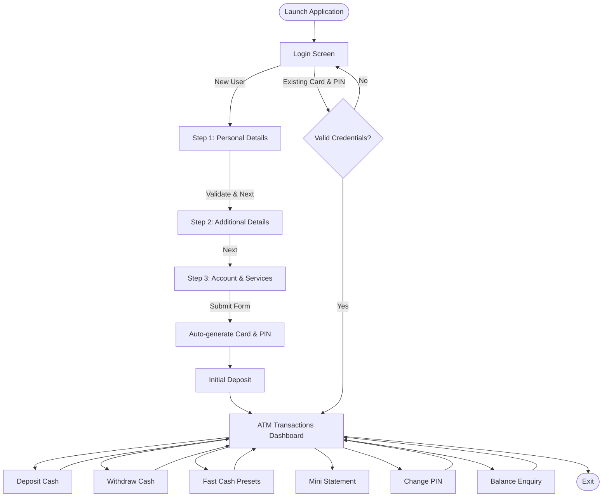

# 🏦 Bank Management System (ATM Simulator)

[](https://www.java.com/)
[](https://docs.oracle.com/javase/8/docs/technotes/guides/swing/)
[](https://www.mysql.com/)
[](https://netbeans.apache.org/)

A desktop-based **Bank Management & Automated Teller Machine (ATM) Simulation System** developed in Java using **Swing** and **AWT** for the graphical user interface, integrated with **MySQL/MariaDB** via **JDBC** for secure transaction and customer data storage.

This project delivers a multi-stage customer onboarding process (Account Application) followed by a full-fledged ATM interface enabling users to conduct everyday banking transactions such as cash deposits, cash withdrawals, fast cash, PIN management, balance enquiries, and viewing transaction mini-statements.

---

## 📑 Table of Contents

- [Features](#-features)
  - [1. User Authentication (Login)](#1-user-authentication-login)
  - [2. Multi-Step Customer Sign-Up](#2-multi-step-customer-sign-up)
  - [3. ATM Operations Dashboard](#3-atm-operations-dashboard)
- [Application Flow](#-application-flow)
- [Tech Stack & Dependencies](#-tech-stack--dependencies)
- [Project Directory Structure](#-project-directory-structure)
- [Database Schema & Setup](#-database-schema--setup)
- [Installation & Setup](#-installation--setup)
- [Configuration](#-configuration)
- [Compilation & Execution](#-compilation--execution)
- [Security Considerations & Future Enhancements](#-security-considerations--future-enhancements)
- [Author](#-author)

---

## ✨ Features

### 1. User Authentication (Login)
- **ATM Card Sign-In**: Login using a 16-digit Card Number and 4-digit PIN.
- **Form Reset**: Quick `CLEAR` button to clear input fields.
- **Direct Navigation to Registration**: `SIGN UP` button to open a new account application.

### 2. Multi-Step Customer Sign-Up
A comprehensive 3-step registration workflow mimicking real banking onboarding:

* **Step 1: Personal Details (`SignupOne`)**
  - Auto-generated unique 4-digit Application Form Number.
  - Full Name, Father's Name, and Date of Birth selection via interactive calendar picker (`JDateChooser`).
  - Gender selection (Male / Female / Others).
  - Email address and Marital status (Married / Unmarried).
  - Residential Address, City, State, and Pin Code with input validation.

* **Step 2: Additional Details (`SignupTwo`)**
  - Demographic & Financial Details: Religion, Category, Annual Income bracket.
  - Education & Occupation: Educational qualifications and occupation classification.
  - Identification: PAN Number and Aadhaar Number.
  - Status Indicators: Senior Citizen check and Existing Account check.

* **Step 3: Account Specifications & Card Generation (`SignupThree`)**
  - Account Category: Savings Account, Fixed Deposit, Current Account, or Recurring Deposit.
  - Automated Generation: Generates an authentic 16-digit ATM Card Number (prefixed with `55082396...`) and a secure 4-digit PIN.
  - Value-Added Banking Services: ATM Card, Internet Banking, Mobile Banking, Email/SMS Alerts, Cheque Book, and E-Statement services.
  - Legal declaration checkbox and cancellation rollback support (cleans up partial form entries if cancelled).
  - Redirects directly to the initial deposit screen upon successful submission.

### 3. ATM Operations Dashboard
Realistic ATM interface themed with ATM bezel graphics (`icons/atm.jpg`):

- **💰 Cash Deposit (`Deposite`)**: Deposit funds into the account with live date/time logging.
- **💵 Cash Withdrawal (`Withdrall`)**: Custom cash withdrawal with real-time balance checks to prevent overdrawing.
- **⚡ Fast Cash (`Fastcash`)**: Quick pre-set withdrawal buttons (₹100, ₹500, ₹1,000, ₹2,000, ₹5,000, ₹10,000) with automatic balance deduction.
- **🔍 Balance Enquiry (`Balancecheck`)**: Real-time calculation of account balance dynamically derived from the transaction ledger.
- **📄 Mini Statement (`Ministatement`)**: Shows masked card number (e.g., `5508XXXXXXXX5525`), formatted transaction history (date, credit/debit type, amount), and final balance.
- **🔒 PIN Change (`Pinchange`)**: Update account PIN with old-PIN authentication, matching confirmation, and database-wide collision check.

---

## 🔄 Application Flow



---

## 🛠 Tech Stack & Dependencies

| Component | Technology / Library | Purpose |
| :--- | :--- | :--- |
| **Language** | Java (JDK 8 / 11 / 17 / 21+) | Core application logic |
| **GUI Toolkit** | Java Swing & AWT | Graphical user interface and custom UI components |
| **Database** | MySQL / MariaDB Server | Persistent storage for users, accounts, and transactions |
| **Database Driver** | `mysql-connector-java-8.0.28.jar` / `mariadb-java-client-3.5.3.jar` | JDBC communication between Java and the database |
| **Calendar Picker** | `jcalendar-tz-1.3.3-4.jar` (`com.toedter.calendar`) | Visual Date of Birth chooser in Sign-Up Step 1 |
| **Build Tool** | Apache Ant / NetBeans Build System | Project compilation, packaging, and dependency execution |

---

## 📁 Project Directory Structure

```text
Bank Management System/
├── build.xml                           # Ant build configuration
├── manifest.mf                         # Application manifest
├── jcalendar-tz-1.3.3-4.jar            # Calendar GUI component library
├── mysql-connector-java-8.0.28.jar     # MySQL JDBC driver library
├── nbproject/                          # NetBeans project metadata and properties
│   ├── project.properties
│   └── project.xml
└── src/                                # Application source root (Git repository root)
    ├── README.md                       # Project documentation
    ├── icons/                          # Application image assets
    │   ├── atm.jpg                     # ATM frame graphic
    │   └── logo.jpg                    # Bank / ATM emblem
    └── bank/
        └── management/
            └── system/
                ├── Conn.java           # Database connection establishment (JDBC)
                ├── Login.java          # Entry point & ATM card sign-in screen
                ├── SignupOne.java      # Registration Step 1: Personal info
                ├── SignupTwo.java      # Registration Step 2: KYC & financial info
                ├── SignupThree.java    # Registration Step 3: Account type & services
                ├── Transaction.java    # ATM transaction options dashboard
                ├── Deposite.java       # Cash deposit screen
                ├── Withdrall.java      # Custom cash withdrawal screen
                ├── Fastcash.java       # Instant pre-set withdrawal screen
                ├── Balancecheck.java   # Real-time balance enquiry screen
                ├── Ministatement.java  # Mini statement & transaction history
                └── Pinchange.java      # Secure PIN update screen
```

---

## 🗄 Database Schema & Setup

The system relies on a MySQL/MariaDB database named `bankmanagementsystem`.

Log into your MySQL / MariaDB client and execute the following SQL script to set up the database and tables:

```sql
CREATE DATABASE IF NOT EXISTS bankmanagementsystem;
USE bankmanagementsystem;

-- Table 1: Personal details (Step 1 of Signup)
CREATE TABLE IF NOT EXISTS signup (
    formno VARCHAR(20),
    name VARCHAR(50),
    fname VARCHAR(50),
    dob VARCHAR(30),
    gender VARCHAR(20),
    email VARCHAR(100),
    marital_status VARCHAR(20),
    address VARCHAR(150),
    city VARCHAR(50),
    state VARCHAR(50),
    pin VARCHAR(20)
);

-- Table 2: Additional details (Step 2 of Signup)
CREATE TABLE IF NOT EXISTS signuptwo (
    formno VARCHAR(20),
    religion VARCHAR(30),
    category VARCHAR(30),
    income VARCHAR(50),
    education VARCHAR(50),
    occupation VARCHAR(50),
    pan VARCHAR(30),
    aadhar VARCHAR(30),
    seniorcitizen VARCHAR(10),
    existingaccount VARCHAR(10)
);

-- Table 3: Account details & facilities (Step 3 of Signup)
CREATE TABLE IF NOT EXISTS signupthree (
    formno VARCHAR(20),
    account_type VARCHAR(50),
    card_number VARCHAR(30),
    pin_number VARCHAR(10),
    facility VARCHAR(200)
);

-- Table 4: Authentication credentials
CREATE TABLE IF NOT EXISTS login (
    formno VARCHAR(20),
    card_number VARCHAR(30),
    pin_number VARCHAR(10)
);

-- Table 5: Transaction ledger
CREATE TABLE IF NOT EXISTS bank (
    pin VARCHAR(10),
    date VARCHAR(50),
    type VARCHAR(20),
    amount VARCHAR(20)
);
```

---

## ⚙️ Configuration

Ensure your database connection details match your local server environment in [`Conn.java`](file:///home/saswata/NetBeansProjects/Bank%20Management%20System/src/bank/management/system/Conn.java):

```java
// Default configuration in Conn.java:
c = DriverManager.getConnection(
    "jdbc:mariadb://localhost:3306/bankmanagementsystem", 
    "root", 
    "2005" // Replace with your MySQL/MariaDB root password
);
```

> [!NOTE]
> If you are using standard MySQL instead of MariaDB, you can adjust the JDBC connection string to:
> `jdbc:mysql://localhost:3306/bankmanagementsystem`

---

## 🚀 Installation & Setup

### Prerequisites
1. **Java Development Kit (JDK 8 or higher)** installed on your machine.
2. **MySQL or MariaDB Server** installed and running on port `3306`.
3. An IDE such as **Apache NetBeans**, **IntelliJ IDEA**, **Eclipse**, or **VS Code**.

---

### Option A: Running with NetBeans IDE (Recommended)
1. Open **Apache NetBeans**.
2. Select **File** > **Open Project...** and select the `Bank Management System` directory.
3. Verify that the required libraries (`jcalendar-tz-1.3.3-4.jar` and `mysql-connector-java-8.0.28.jar`) are listed under the **Libraries** node.
4. Verify your database is running and the database schema is created.
5. Right-click on the project and select **Run** (or press `F6`).

---

### Option B: Running via Command Line

1. **Navigate to the project root directory**:
   ```bash
   cd "/home/saswata/NetBeansProjects/Bank Management System"
   ```

2. **Create the build/classes directory**:
   ```bash
   mkdir -p build/classes
   ```

3. **Compile the Java sources with the required JARs on the classpath**:
   ```bash
   javac -cp ".:jcalendar-tz-1.3.3-4.jar:mysql-connector-java-8.0.28.jar" -d build/classes src/bank/management/system/*.java
   ```

4. **Copy the icons asset folder into the build classes directory**:
   ```bash
   cp -r src/icons build/classes/
   ```

5. **Run the application**:
   ```bash
   java -cp "build/classes:jcalendar-tz-1.3.3-4.jar:mysql-connector-java-8.0.28.jar" bank.management.system.Login
   ```

---

## 💡 Usage Guide

1. **Starting the Application**: Run [`Login.java`](file:///home/saswata/NetBeansProjects/Bank%20Management%20System/src/bank/management/system/Login.java) to launch the welcome screen.
2. **New Customer Registration**:
   - Click **SIGN UP** on the login page.
   - Complete Page 1 (Personal Details) and click **Next**.
   - Complete Page 2 (Additional KYC Info) and click **Next**.
   - Select Account Type and desired Banking Services on Page 3, accept terms, and click **Submit**.
   - Note down the generated 16-digit Card Number and 4-digit PIN presented in the confirmation dialogue.
   - Make an initial deposit on the prompt to activate your balance.
3. **ATM Usage**:
   - Sign in using your Card Number and PIN.
   - Select any transaction: **Deposite**, **Cash Withdrall**, **Fast Cash**, **Mini Statement**, **Pin Change**, or **Balance Enquery**.
   - Click **Exit** or **Back** to return to the main dashboard or terminate the session safely.

---

## 🛡️ Security Considerations & Future Enhancements

- [ ] **Parameterized Queries (`PreparedStatement`)**: Upgrade dynamic SQL queries in JDBC calls to `PreparedStatement` to guard against SQL injection.
- [ ] **Secure Credential Storage**: Hash PIN numbers and passwords using modern cryptographic algorithms (e.g., BCrypt or Argon2) instead of plain-text representations.
- [ ] **Dynamic Layout Management**: Transition fixed coordinates (`setLayout(null)` / `setBounds`) to flexible Swing layout managers (`GridBagLayout`, `MigLayout`, or `BorderLayout`) for DPI scaling and cross-platform responsiveness.
- [ ] **Statement Export**: Implement PDF or receipt export for mini-statements using libraries such as iText or Apache PDFBox.
- [ ] **Session Timeout**: Add an automated inactivity timer to log out ATM sessions after periods of idle time.

---

## 👤 Author

Developed by **Saswata** ([@SaswataNX05](https://github.com/SaswataNX05)).

Feel free to fork, open an issue, or submit a pull request if you have ideas for improvements!
